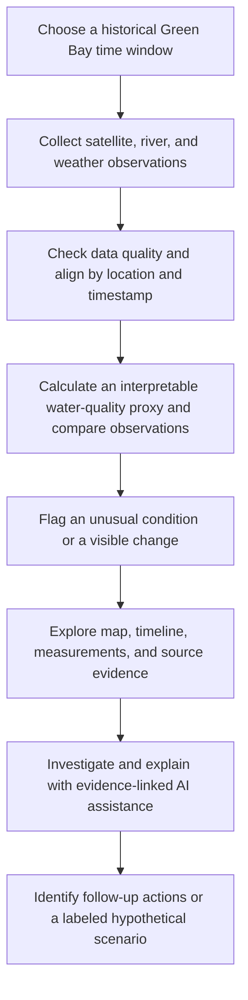

# FoxWatch — Watershed Intelligence & Incident Response

**Foundational Design Document · October 17, 2026**  
**Status:** Concept and scope definition; data and model feasibility remain to be validated  
**Primary use case:** Historical water-quality investigation in the Lower Fox River and Green Bay  
**HackGB main track:** Environment & Sustainability

> **Product statement:** FoxWatch brings satellite imagery, river observations, and weather records into one historical timeline so a user can identify unusual water conditions, inspect the evidence behind a flag, and decide what to investigate next.
>
> **Design principle:** Build one credible investigation workflow first. Add new models, larger datasets, advanced simulations, and infrastructure only after that workflow is proven.

## Table of Contents

1. [Problem / Opportunity](#problem--opportunity)
2. [Current State — What We Have](#current-state--what-we-have)
3. [Constraints & Assumptions](#constraints--assumptions)
4. [Options Considered](#options-considered)
5. [Proposed Solution](#proposed-solution)
   - [Core User Experience](#core-user-experience)
   - [End-to-End Workflow](#end-to-end-workflow)
   - [What Needs to Be Built](#what-needs-to-be-built)
   - [Research and Validation Questions](#research-and-validation-questions)
   - [Deliverables and Milestones](#deliverables-and-milestones)
6. [Additional Discussion](#additional-discussion)
7. [Appendix](#appendix)

---

## Problem / Opportunity

Water quality in the Lower Fox River and Green Bay is influenced by multiple environmental factors. Relevant observations exist across satellite platforms, river monitoring stations, and weather records, but these sources are not naturally presented as one coherent historical account.

A person investigating an unusual water-color signal must determine **when it appeared, where it occurred, what other observations were available, how trustworthy the signal is, and what further investigation is warranted**.

**FoxWatch's opportunity** is to make that investigation fast, visual, and evidence-driven. Its intended users include watershed researchers, environmental organizations, educators, and local water-quality stakeholders.

The first release is **not** a real-time harmful-algal-bloom warning system or a validated forecasting model. It is a historical investigation and demonstration tool.

## Current State — What We Have

The team has established a product direction and identified promising data sources and capabilities. The existing design drafts and whiteboard are **plans**, not proof that datasets, trained models, or deployed features are already working.

| Area | Established direction | Still unknown or unproven |
|---|---|---|
| **Geographic focus** | Lower Fox River and Green Bay | The exact area and historical event to demonstrate |
| **Satellite source** | Sentinel-2 imagery for observing water-color and spectral changes | Availability of a usable, sufficiently cloud-free pair of scenes |
| **River observations** | USGS gauge data for watershed context | Station coverage, variables, timestamps, and availability for the chosen window |
| **Weather observations** | NOAA rainfall and temperature records | Matching stations, units, resolution, and gaps |
| **Analysis** | Detect unusual satellite-derived water conditions | Appropriate proxy, comparison baseline, quality controls, and evaluation criteria |
| **Investigation** | Interactive map, timeline, evidence inspection, and Gemini-assisted questions | Source-backed explanation and citation behavior in a working demo |
| **Response** | Clearly labeled what-if scenarios and follow-up recommendations | Which scenario assumptions can be defended with available evidence |

**Immediate reality check:** No particular bloom date, successful data download, model performance, or end-to-end feature is treated as verified in this document. Those are early project milestones, not assumptions to hide.

## Constraints & Assumptions

- **Historical first.** Replay a selected period rather than claiming continuous monitoring or a reliable current-bloom assessment.
- **Scientific accuracy over impressive terminology.** A satellite-derived spectral indicator is a *proxy*, not a lab-confirmed chlorophyll concentration, cyanobacteria species identification, toxin measurement, or proof of a harmful bloom.
- **Different observation intervals.** Satellite scenes, river gauges, and weather measurements may occur at different times. Display actual timestamps and gaps; do not manufacture intermediate observations.
- **Quality is part of the result.** Clouds, haze, atmospheric effects, shoreline contamination, sediment, and missing records can affect interpretation. Show limitations visibly.
- **One working story over many integrations.** The minimum product needs a credible map-and-evidence workflow; advanced training, HPC expansion, and optional sponsor features are secondary.
- **Simple implementation.** The product may be built as one web application with a data-processing workflow. Service boundaries, hosting platform, and low-level implementation choices are intentionally out of scope here.
- **Hackathon requirements.** The provided participant guide requires newly created project code, one main track, a public repository, AI/tool disclosures, and a demo video of at most three minutes. A draft submission is scheduled for Saturday night and final submission for Sunday at noon, per the event's local schedule.

## Options Considered

These are *product and scientific scope* choices, not infrastructure decisions.

| Decision | Option | Current position | Reason |
|---|---|---|---|
| **What to investigate** | Documented historical bloom window vs. arbitrary image change | **Prefer a documented event**, if usable imagery and supporting records exist | Stronger scientific and demo narrative; otherwise accurately present an unusual water-color observation |
| **First analysis** | Interpretable satellite proxy and change analysis vs. newly trained model | **Start with a transparent proxy and quality screening** | Training requires suitable labels, enough examples, and evaluation time |
| **Detection language** | Confirmed bloom, bloom risk, or unusual spectral condition | **Flag unusual spectral conditions** | Avoid presenting a proxy as a diagnostic test |
| **Explanation** | Evidence-linked inspection vs. unbounded AI claims | **Evidence first, AI second** | Users must be able to review the underlying observations independently |
| **Response modeling** | Quantitative environmental forecast vs. explicitly hypothetical exploration | **Treat scenarios as optional, assumption-based demonstrations** | Correlation alone does not support causal runoff predictions |

## Proposed Solution

### Core User Experience

A user opens FoxWatch and chooses a historical period in Green Bay. They see satellite imagery and a synchronized record of available river and weather observations. The platform highlights an unusual water-quality *proxy* signal, allows the user to examine its context and limitations, and offers a concise explanation grounded in the displayed evidence.

A successful demonstration follows five questions:

1. **What changed?** Compare actual satellite observations across dates.
2. **Where and when?** Locate the change and inspect the time of each measurement.
3. **How unusual is it?** Show a comparison against an appropriate baseline, or label it simply as an observed change if no baseline exists.
4. **What evidence supports this interpretation?** Examine images, measurements, missing data, and source citations; optionally ask Gemini to summarize them.
5. **What should happen next?** Recommend a sensible verification step and, only if defensible, explore a transparently hypothetical response scenario.

### End-to-End Workflow

**Example behavior (illustrative, not a verified historical event):** A user selects two clear satellite observations. FoxWatch shows that the water-color proxy increased in part of the bay, while nearby rainfall observations provide additional context. The application marks the change, states the imagery quality and observation dates, and lets the user ask, “What evidence supports this flag?” The answer links to the two imagery analyses and relevant weather/gauge records while explaining that the pattern does **not** establish a confirmed harmful algal bloom.

### What Needs to Be Built

| Capability | Expected behavior | Minimum deliverable |
|---|---|---|
| **Historical case study** | Open one well-defined region and date window | A documented example window or transparently labeled proxy-change case |
| **Unified observations** | View satellite, river, and weather information on a shared timeline without erasing differing observation times | A small, real, attributable dataset spanning the case study |
| **Water-quality analysis** | Produce a satellite-derived indicator, mask unusable observations, and compare valid scenes | At least two interpretable map views, quality indicators, and one change result |
| **Condition flag** | Clearly state what crossed a baseline or what changed | One explainable flag with rationale, timestamp, location, and evidence |
| **Evidence explorer** | Scrub time, compare imagery, view environmental charts, and inspect source references | One intuitive screen connecting map, timeline, chart, and evidence |
| **Assisted investigation** | Answer bounded questions using actual retrieved evidence; acknowledge gaps | One reliable, cited investigation or incident summary |
| **Follow-up/response** | Explain what a user should verify next | A responsible action recommendation; hypothetical scenarios only if clearly qualified |
| **Public demonstration** | Tell the full investigation story without relying on unsupported claims | Working demo, concise video, README, data attribution, and AI disclosure |

### Research and Validation Questions

The most important research is **feasibility of the evidence**, not searching for more models or sponsors.

| Priority | Question | Decision or artifact required |
|---|---|---|
| **Critical** | Which historical period has a documented water-quality concern and at least two usable Sentinel-2 scenes? | Chosen time window, area of interest, source references, and confirmed imagery examples |
| **Critical** | What can the chosen satellite bands actually support in these waters? | Selected proxy, quality limitations, and defensible wording for its output |
| **Critical** | Which USGS and NOAA observations exist for the same period? | Source/station list, measured variables, units, observation frequency, and gaps |
| **Critical** | What makes a change notable instead of routine or caused by artifacts? | Defined comparison baseline or explicit decision to show change without statistical anomaly claims |
| **High** | Are there trustworthy independent water-quality observations for evaluation? | Validation evidence, or a clearly stated inability to validate bloom classification |
| **High** | What is the smallest useful evidence record for the investigation? | Agreed source, timestamp, place, measurement/proxy, quality, and citation fields |
| **High** | What questions can Gemini answer without guessing? | Small set of supported questions and answer/citation acceptance tests |
| **Optional** | Is there a scientifically supportable relationship for scenario exploration? | Explicit assumptions and limitations; otherwise postpone numerical scenarios |
| **Future** | Do labeled datasets justify a trainable bloom classifier or multi-output model? | Data and evaluation plan before committing to training |

### Deliverables and Milestones

Milestones are defined by **working evidence and user-visible outcomes**, not by technology integrations.

| Milestone | Work | Exit criterion |
|---|---|---|
| **1. Establish the case** | Confirm a region, historical window, source availability, and feasible scientific claim | A specific story grounded in real accessible observations |
| **2. Establish the evidence** | Collect, inspect, and align usable imagery, gauge, and weather records | A coherent time window with known timestamps, gaps, and source references |
| **3. Establish the signal** | Generate water-quality proxy maps, compare scenes, and describe data quality | A visible, explainable change or defensible anomaly flag |
| **4. Build the investigation** | Connect the map, timeline, contextual charts, and evidence drill-down | A user can inspect a flag and independently trace its supporting data |
| **5. Add the explanation** | Introduce bounded, evidence-citing Gemini assistance and an incident summary | A useful answer that cites real records and admits uncertainty |
| **6. Validate and present** | Test the narrative, remove exaggerated claims, and prepare the public demo | A reproducible three-minute presentation and complete submission |

**Minimum viable FoxWatch:** Milestones 1–4 plus the final demonstration. Milestone 5 materially improves the experience if it works reliably. An elaborate scenario simulator, new training pipeline, and additional providers are **not prerequisites** for a successful first version.

## Additional Discussion

### What We Are Deliberately Not Building Yet

- A network of separately deployed microservices or complicated orchestration.
- A newly trained two-head model without confirmed labels and evaluation data.
- Real-time bloom alerts, validated ecological forecasts, or claims of identified toxins.
- Large-scale multi-year processing solely to demonstrate compute capacity.
- A generalized platform for every watershed before one case study works.
- Hardware, blockchain provenance, voice synthesis, or extra sponsor integrations that distract from the investigation workflow.

### Path to Future Research and Scaling

Once the first case study is usable and credible, FoxWatch can become a broader research platform without changing the product's basic experience:

| Later phase | Possible direction | Prerequisite |
|---|---|---|
| **More historical coverage** | Additional dates, locations, watershed records, and documented events | Reliable data alignment and quality tracking |
| **Better scientific models** | Learned bloom-risk classification, multi-output models, or image segmentation | Representative labeled examples, baseline comparisons, and held-out validation |
| **Environmental research** | Study correlations and lag relationships among rainfall, river conditions, and satellite signals | Sufficient temporal coverage and appropriate statistical methods |
| **Scenario modeling** | Calibrated simulations and sensitivity analysis | Scientific model selection, independent validation, and clearly stated assumptions |
| **Operational use** | Periodic ingestion, monitoring workflows, alerts, and multiple regions | Demonstrated performance, validation, reliability, and operational requirements |
| **Larger compute/infrastructure** | HPC-scale processing, managed inference, or independent services | Genuine workload, reliability, or collaboration needs that justify complexity |

The stable concept is **observations → quality checks → interpretable signal → evidence → investigation → action**. Future models can improve the signal without requiring the initial product to become complicated.

### Open Decisions

- Which exact location and historical date range will anchor the first replay?
- Do we have two genuinely comparable satellite observations, or only one usable image?
- Can we honestly call the result an *anomaly*, or should the first release say *observed spectral change*?
- Is there independent evidence of an actual bloom, or is the example limited to a water-color proxy?
- Which feature is the true demo centerpiece: the visible change, the evidence inspection, or the AI investigation? (Suggested answer: evidence inspection.)

## Appendix

### Evidence and Language Guidelines

| Prefer | Avoid unless independently validated |
|---|---|
| “Satellite-derived water-color/chlorophyll-related proxy” | “Measured chlorophyll concentration” |
| “Unusual spectral condition” or “Observed change” | “Confirmed harmful algal bloom” |
| “Nearby rainfall and river observations provide context” | “Rainfall caused this bloom” |
| “Quality limitations / sensitivity / unavailable observations” | “99% confidence” without a validated confidence model |
| “Hypothetical effect under stated assumptions” | “Predicted impact of runoff reduction” |
| “Historical replay” | “Live monitoring” |

### Starting References

The following are identified inputs and starting points, not evidence that retrieval or scientific validation has already succeeded.

- **Team whiteboard (October 17, 2026):** historical replay, three data sources, data cleaning/labeling, possible two-head model, anomaly flags, bounded Gemini tools, and scenario exploration.
- **Earlier FoxWatch research and architecture drafts:** candidate data sources, technical ideas, and demo direction; many examples and claims were illustrative and require confirmation.
- **HackGB 2026 Participant Guide:** one main track; code freshness, submission, video, and AI disclosure requirements.
- [Copernicus Data Space Ecosystem](https://dataspace.copernicus.eu/) — candidate Sentinel-2 imagery source.
- [USGS Water Data](https://waterdata.usgs.gov/) — candidate river observations.
- [NOAA NCEI](https://www.ncei.noaa.gov/) — candidate historical weather observations.

---

**Definition of success:** A judge can see one real historical change, understand how it was identified, inspect its actual supporting evidence and limitations, and understand what FoxWatch recommends investigating next. Everything else can evolve afterward.
